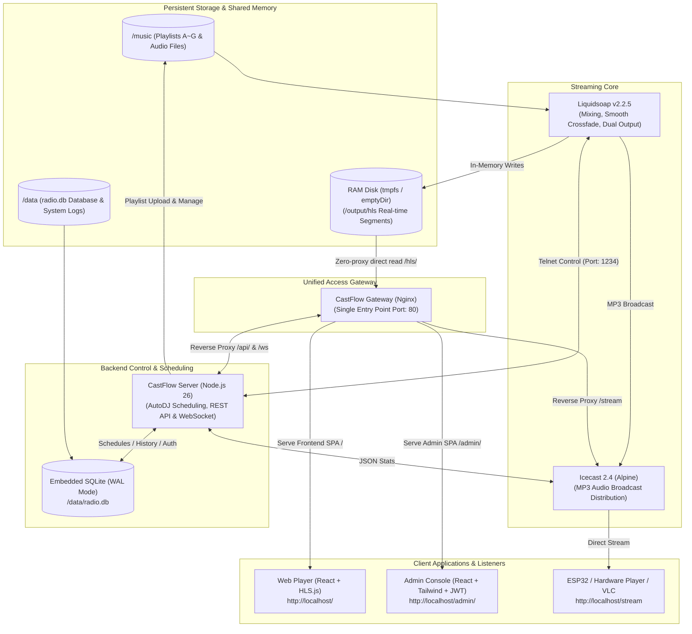

# CastFlow 📻

**English** | [繁體中文](README.zh-TW.md)

> **CastFlow** is a modern, cloud-native automated audio broadcasting and stream scheduling platform with dual Web UIs.  
> Designed for indie artists, radio station hosts, developers, and homelab enthusiasts, CastFlow delivers dual-stream outputs for both IoT hardware (ESP32, VLC) and modern web browsers (Web HLS). It features intuitive visual scheduling, auto-shuffling, hourly interstitials, and broadcast-grade smooth crossfades.

---

## Architecture



---

## Key Features

* ☁️ **Cloud-Native Microservices & Flexible Deployment**:
  * **Docker Compose**: One-click startup in seconds for standalone servers or homelab.
  * **Komodo + Traefik**: Pull-model deployment from prebuilt GHCR images behind a Traefik reverse proxy (see below).
* 📻 **Dual-Track Stream Output**:
  * **Icecast MP3 Stream (`/stream`)**: Direct streaming for ESP32/Arduino IoT devices and legacy players (VLC, foobar2000).
  * **Web HLS Stream (`/hls`)**: Powered by HLS.js for low-latency, stutter-free playback across all modern desktop and mobile browsers.
* ⚡ **Real-Time WebSocket Sync (`/ws`)**: Sub-second push notifications for track changes, playback progress, and listener count without polling.
* 🗄️ **Embedded SQLite Database**: Zero external database dependencies; runs WAL mode at `/data/radio.db` for playback history, custom schedule rules, and administrator credentials (isolated from `/music` to prevent conflicts during audio backups).
* 🔐 **Security & Access Control**:
  * Auto-generates a secure random administrator password upon initial boot (e.g., `cf_xxxxxx`).
  * Public endpoints (streams, status, history, album covers) are freely accessible.
  * Administrative operations (track skipping, folder reload, uploads, schedule configuration, full backup/restore) are strictly protected by JWT signatures.
* 🎛️ **Flexible AutoDJ Scheduling Engine**:
  * Supports continuous daily rotation with weighted ratios and specific time windows (including cross-midnight support).
  * Supports hourly / recurring interstitials (e.g., chime or jingle at :00 or :30 past every hour).
  * Features smooth crossfades and high-priority dynamic queue injection via Telnet.
* 🖥️ **Modern Dual Web Applications**:
  * **Listener Player**: Rotating vinyl turntable animation, dynamic album art, upcoming track queue, and keyboard shortcuts (Space to Play/Pause, F for Fullscreen).
  * **Admin Console**: Drag-and-drop playlist management (MP3/ZIP/folders), live audio preview monitoring, visual scheduling manager, real-time log inspector, and comprehensive backup/restore.

---

## Default Playlists & Scheduling Logic

Playlists A through G are preconfigured with intuitive roles:

| Directory | Role | Default Behavior |
| :--- | :--- | :--- |
| **`/music/A`** | Daily Core Rotation | **75% weight** during regular hours; 3:1 rotation ratio with Playlist B |
| **`/music/B`** | Daily Secondary Interstitial | **25% weight** during regular hours; 1 song every 3 songs from A |
| **`/music/C`** | Hourly Dedicated Interstitial | Plays 1 song at the beginning of each hour after current song finishes (`wait_track_end`) |
| **`/music/D`** | 21:30 Timed Interstitial | Smooth crossfade at 21:30 |
| **`/music/E`** | 21:40 Timed Interstitial | Smooth crossfade at 21:40 |
| **`/music/F`** | 21:50 Timed Interstitial | Smooth crossfade at 21:50 |
| **`/music/G`** | Late Night Relaxing Stream | 22:00 ~ 23:00 rotated with Playlist A at **1:1 ratio** |

* General rule: Playlists load in randomized/shuffle mode. All track transitions are protected by broadcast-grade smooth crossfading.
* Every schedule can have an inclusive start and end date. Leave both blank for no date limit, or set either bound alone. Dates use the server container's local time zone and combine with weekday and time-window conditions. Tracks already queued continue playing.

---

## Quick Start (Docker Compose)

### 1. Clone the repository
```bash
git clone https://github.com/fly530/CastFlow.git
cd CastFlow
```

### 2. Create `.env` (REQUIRED — compose refuses to start without it)

Generate the keys on the spot; there is nothing to invent by hand:

```bash
cat > .env <<EOF
JWT_SECRET=$(openssl rand -hex 32)
ICECAST_SOURCE_PASSWORD=$(openssl rand -hex 16)
ICECAST_ADMIN_PASSWORD=$(openssl rand -hex 16)
EOF
```

> Do not just `cp .env.example .env` and run — it holds placeholder strings that
> the server recognises and refuses to start on. The example file documents which
> variables exist; it is not meant to be used as-is.
>
> `JWT_SECRET` signs admin credentials, so a predictable value is the same as no
> authentication at all. `ICECAST_SOURCE_PASSWORD` doubles as the password
> Liquidsoap uses to push the stream — both sides share the one key.

### 3. Start all services
```bash
docker compose up -d
```

### 4. Retrieve Initial Admin Password
On first startup, a secure administrator password is automatically created:
```bash
docker logs castflow-server | grep -E "Password|admin"
```

### 5. Service Access Endpoints (Unified via Port 80 Gateway)
* **Web Player (Listener UI)**: [http://localhost](http://localhost) (Standard Port 80)
* **Admin Dashboard (Console)**: [http://localhost/admin/](http://localhost/admin/)
* **Backend API & WebSocket Server**: `http://localhost/api` / `ws://localhost/ws` (Internal reverse proxy)
* **Icecast MP3 Stream**: `http://localhost/stream` (ESP32 / VLC / Hardware player)
* **HLS Web Stream**: `http://localhost/hls/live.m3u8`

---

## Komodo + Traefik Deployment (pull model)

GitHub Actions builds `castflow-server` / `castflow-gateway` and pushes them to GHCR; the host only pulls.
Use [`compose.komodo.yaml`](./compose.komodo.yaml) (no published port, joins the external `proxy-net` for Traefik, data in host dir `CASTFLOW_DATA_DIR`, create it first and `chown -R 1000:1000` it).

1. Create a Komodo Stack from this repo, **File Paths** = `compose.komodo.yaml`.
2. Stack **Environment**: `JWT_SECRET`, `ICECAST_SOURCE_PASSWORD`, `ICECAST_ADMIN_PASSWORD`, `CASTFLOW_HOST`, `CASTFLOW_DATA_DIR` (see `.env.example`).
   Optional `TRUST_PROXY`: which proxies' `X-Forwarded-For` the server believes (login rate limiting and logs use the client IP).
   Empty means private networks only, which covers the gateway and Traefik. If another public proxy sits in front (e.g. Cloudflare), set its CIDR or a hop count such as `2`.
3. If the GHCR packages are private, set the Image Registry of the Stack to `ghcr.io` (PAT with `read:packages`).
4. Enable **Poll for Updates** + **Auto Update**. To roll back, pin the image tag to `sha-<short>`.

---

## Scheduling Runtime Dependency

All scheduling decisions live in the backend Node.js AutoDJ scheduler (a 5-second tick),
which pushes tracks into Liquidsoap over Telnet: regular rotation goes into `dynamic_queue`
(kept ~3 tracks ahead), fixed-time / hourly inserts go into `priority_queue`, which plays as
soon as the current track ends. `radio.liq` itself only handles the queues and crossfades —
it contains no time-of-day logic. After updating `radio.liq`, restart the `liquidsoap`
container (`docker compose restart liquidsoap`); until then inserts fall back to the end of
`dynamic_queue`. That is what makes
admin-console schedule edits take effect immediately without reloading Liquidsoap.

The trade-off: **when the `server` container is down, scheduling stops**. Broadcast does not go
silent (an empty `dynamic_queue` falls back to shuffling playlist A), but it quietly
degrades to A-only with no visible error. Wire `server`'s `/health` into your alerting.

---

## REST API & WebSocket Summary

| Method / Protocol | Endpoint | Authentication | Description |
| :--- | :--- | :--- | :--- |
| `WS` | `/ws` | Public | Real-time push notifications (track changes, progress, listener counts) |
| `GET` | `/health` | Public | Server health status & Telnet connection probe |
| `GET` | `/api/status` | Public | Unified broadcast status (now playing, progress, listeners, stats) |
| `GET` | `/api/history` | Public | Recent playback history (SQLite) |
| `GET` | `/api/current/cover`| Public | Album artwork image for currently playing track |
| `POST`| `/api/auth/login` | Public | Admin login endpoint returning JWT token (10 attempts per IP per 15 minutes, then `429`) |
| `GET` | `/api/auth/me` | JWT Required | Returns current authenticated administrator info |
| `POST`| `/api/auth/change-password` | JWT Required | Change administrator password; returns a new token and invalidates every previously issued one |
| `POST`| `/api/control/skip` | JWT Required | Skip currently playing track |
| `POST`| `/api/control/reload` | JWT Required | Force reload of all playlist audio folders |
| `POST`| `/api/control/telnet` | JWT Required | Execute raw Liquidsoap Telnet commands |
| `GET` | `/api/playlists` | Public | List all playlists and track counts |
| `GET` | `/api/playlists/:id/tracks` | Public | List tracks and ID3 metadata for a playlist |
| `POST`| `/api/playlists/:id/upload` | JWT Required | Upload MP3/ZIP/folders to a playlist |
| `DELETE`| `/api/playlists/:id/tracks/:filename` | JWT Required | Delete a track from a playlist |
| `GET` | `/api/schedules` | Public | Retrieve all visual scheduling rules |
| `POST`| `/api/schedules` | JWT Required | Create a new scheduling rule (continuous or recurring) |
| `PUT` | `/api/schedules/:id` | JWT Required | Update an existing scheduling rule |
| `DELETE`| `/api/schedules/:id` | JWT Required | Delete a scheduling rule |
| `POST`| `/api/schedules/:id/trigger` | JWT Required | Play a rule's playlist now (via the priority queue) |
| `GET` | `/api/backups` | JWT Required | List backup files |
| `POST`| `/api/backups` | JWT Required | Create a configuration backup (JSON) |
| `POST`| `/api/backups/full-zip` | JWT Required | Create a full station backup (ZIP with all MP3s and the configuration) |
| `POST`| `/api/backups/:filename/download-link` | JWT Required | Get a short-lived (2 min) download URL bound to that file, so the browser downloads it directly |
| `GET` | `/api/backups/:filename/download` | JWT, or `?token=` from download-link | Download a backup file |
| `POST`| `/api/backups/:filename/restore` | JWT Required | Restore from a stored backup (JSON, or ZIP with its embedded configuration) |
| `POST`| `/api/backups/restore-data` | JWT Required | Restore from an uploaded JSON backup (up to 20 MB) |
| `POST`| `/api/logs/playback` | Public | Listener-side playback diagnostics report (WARN/ERROR only, 30 per IP per minute; `playback.log` rotates at 5 MB) |
| `GET` / `DELETE` | `/api/logs/playback` | JWT Required | Read / clear playback diagnostics (contains listener IPs) |

---

## License, Acknowledgements & Disclaimer

* **License**: Custom application code is licensed under the [MIT License](LICENSE).
* **Open Source Software Disclosures**: Detailed list of upstream open-source software (Liquidsoap, Icecast, Nginx, React, HLS.js, SQLite, etc.) and architectural container boundaries are documented in [ACKNOWLEDGEMENTS.md](ACKNOWLEDGEMENTS.md).
* **Legal & Copyright Disclaimer**: Complete legal disclaimer regarding audio copyright ownership, public performance broadcast compliance, and "AS IS" software liability is provided in [DISCLAIMER.md](DISCLAIMER.md).
